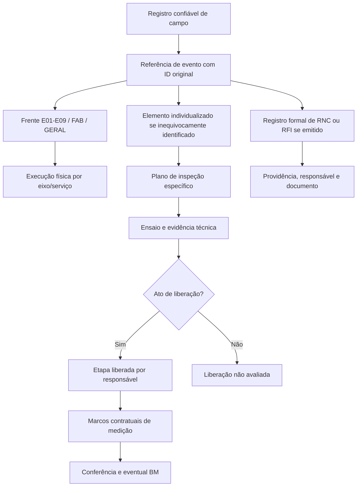

# Ponte da UFPI — Modelo de dados técnico-gerencial v1
**Referência dos dados:** 24/11/2026  
**Empreendimento:** Ponte João Claudino Fernandes (Ponte da UFPI), Teresina–PI  
**Repositório fonte:** `jonasxemerson/RDO_PONTEUFPI`  
**Escopo:** desenho e primeira projeção **não destrutiva**; nenhuma modificação nos sistemas de produção, projeto ou medições contratuais.

## 1. Objetivo e decisão arquitetural

Separar aquilo que **foi relatado com confiabilidade em campo** de quatro julgamentos diferentes: (a) etapa física de execução, (b) conformidade tecnológica, (c) ato de liberação de etapa e (d) aptidão para medição conforme o instrumento contratual. Essas dimensões são independentes. *Um registro pode ter execução reconhecida e continuar com inspeção, medição e liberação ainda não avaliadas.*

O modelo nunca deduz ocorrência de paralisação pelo silêncio entre relatos e nunca transforma ausência de documento em RNC ou bloqueio formal. A ausência é `nao_avaliado`/`nao_configurado`; decisões formais precisam de documento e autoridade.

### 1.1. Fontes e grau de confiabilidade

| Origem | Valor que sustenta | O que não sustenta automaticamente |
|---|---|---|
| `data/indicadores-historicos.json` | Quantitativos agregados históricos e projeto de referência para 9 eixos | Localização de estacas individualizadas, medição e aceite |
| `data/observacoes-2026-11.json` | Atividades e números confiáveis dos 60 registros exportados; 59 homologados pelo responsável e 1 com classificação quantitativa ainda ambígua | Conformidade geométrica, ensaio, aptidão para pagamento |
| `scripts/consolidar_dados.py` | Regra efetiva de reconciliação por último snapshot de campo; separação entre execução e concretagem | Produção diária por subtração entre snapshots |
| Auditoria de 24/11/2026 (pacote local interno) | 20 achados diagnósticos e 14 requisitos documentais propostos | RNC, RFI, decisão administrativa ou notificação efetivamente emitida |
| Relatório de outubro/2026 (acervo documental) | Histórico de contrato/medições e ocorrências até a referência do relatório | Valor vigente, nova medição ou data de conclusão atualizadas em 24/11 |

**Regra de origem:** a projeção armazena SHA-256 por arquivo fonte, além dos identificadores originais de eventos. Ao reprocessar os dados, qualquer alteração de conteúdo exige reconciliação novamente.

## 2. Modelo lógico: do relato à decisão



### 2.1. Chaves e relacionamentos

| Entidade | Chave primária | Relacionamentos e observações |
|---|---|---|
| `eixos` | `E01` … `E09` | Contém execução e concretagem agregadas; **não** individualiza estacas não mapeadas |
| `elementos_individualizados` | `E03-P03`, `E03-P04` quando sustentados por relato | Vincula-se a `eixo_id`; toda individualização exige origem inequívoca; outros elementos permanecem agregados |
| `referencias_eventos` | ID original `wa-...` | Vinculação a `eixo_ou_frente`, eventualmente a elemento; preserva data, serviço, estado, homologação e `review` |
| `documentos` (futuro) | ID imutável local/documental | Projeto, RDO, parecer, laudo, ata, notificação, BM; com versão, classe e permissão |
| `planos_inspecao` (futuro) | ID próprio | Define etapa, ensaio aplicável, critérios e autoridade liberadora por projeto e especificações |
| `ensaios` (futuro) | ID próprio | Referência ao plano e documento de laudo; status não inferido |
| `hold_points` (futuro) | ID próprio | Ligação com plano, frente, elemento e ato de liberação/bloqueio |
| `rnc`, `rfi`, `decisoes` (futuro) | ID próprio | Existência formal apenas com lançamento autorizado; não converter alertas derivados em RNC |
| `medicoes` (futuro) | ID/boletim e item contratual | Medição obedece marcos e condições do contrato, não equivale a soma automática de peças |
| `producao_diaria`, `recursos_diarios` (futuro) | ID de apontamento | Fonte por dia/turno/frente, sem preenchimento sintético em dias sem observação |

### 2.2. Dimensões independentes por eixo

- `estacas_previstas`: quantitativo do projeto disponível na fonte atual (não é necessariamente a quantidade contratual de pagamento por unidade).
- `estacas_execucao_registrada`: valor agregado reconciliado, podendo representar **etapas físicas diferentes** e fontes históricas/campo.
- `estacas_concretagem_identificada`: série distinta; não deriva automaticamente do valor da execução.
- `controle_tecnologico`: `nao_avaliado`, `em_analise`, `conforme`, `nao_conforme`, `nao_aplicavel`. `conforme` precisa de documento técnico.
- `hold_point`: `nao_configurado`, `aguardando_analise`, `liberado_por_ato`, `bloqueado_por_ato`. **O modelo inicial não cria hold points formais**.
- `medicao`: `nao_avaliada`, `em_conferencia`, `apta_por_criterio_contratual`, `retida_por_ato`, `medida`. A aptidão é verificada por critério contratual e ato; não deriva da execução.
- `status_geom`: `nao_verificado_individualmente` até a compatibilização com locação/projeto e cadastro `as-built`.

## 3. Casos já tratados com a base real

### E09 — quantidade executada acima do projeto

- **24 previstas**, **25 executadas relatadas**, **8 com concretagem identificada**. O excedente +1 continua registrado.
- Alerta **derivado** `ALERTA-QUANT-E09` tem `rnc_formal=false`: gera pauta de análise, **não** reprovação nem notificação por si.
- Não são criadas 25 estacas geométricas individualizadas nem se presume invalidez ou contribuição resistente.

### E07 e E08 — etapas intermediárias

- E07: **19 execução registrada / 4 concretagem identificada**, com instalação de armadura da 20ª estaca em andamento e montagem de aparato de prova de carga. **Montagem do aparato não é resultado de ensaio.**
- E08: **13 execução registrada / 11 concretagem identificada**; a 14ª camisa em cravação é um ordinal de atividade, não 14ª concretagem.
- A frase ambígua sobre camisas do E07 (17/11) tem `quantity=null` no relato original; permanece pendente de *classificação*, **sem questionar a confiabilidade do relato literal**.

### E03 — pilares parcialmente concretados

- Apenas `E03-P03` e `E03-P04` são instanciados individualmente porque aparecem com identificação inequívoca no relato.
- Metades inferiores concretadas e fôrmas superiores montadas em 24/11; não contabilizar como dois pilares integralmente concluídos.
- O consolidado preserva seis pilares integralmente concretados, sem adicionar os dois parciais.

### FAB — longarinas, reparos e pré-lajes

- **3 longarinas concretadas** são acumulado de campo; não há lista homologada de identificação individual de todas elas.
- **218 pré-lajes adicionais** relatadas em novembro; estoque total `null`, porque não há reconciliação completa de estoque.
- Relatos de falhas e aplicação de graute são mantidos na origem interna e podem motivar verificação; não se cria RNC nem aceite técnico sem formalização.

## 4. Regras para cronograma, medição e desempenho

1. **SPI/IDP:** somente após importar linha de base aprovada, pesos ou valor agregado (`EV`), valor planejado (`PV`) e metodologia. O cálculo será `EV/PV` com `PV > 0`. Até lá, `idp_spi = null` e semáforo de prazo desabilitado.
2. **Ritmo semanal:** necessita série de **produção incremental** reconciliada por data e serviço. Não calcular pela diferença entre snapshots acumulados de datas distintas sem controle de revisões/deduplicação.
3. **Hold points:** matriz configurável, aprovada conforme projeto, memoriais e plano de inspeção e ensaios. Não transformar automaticamente toda fundação sem PIT em “bloqueada”; ensaios exigíveis variam conforme especificação, elemento e plano.
4. **Medição por preço global:** a execução de uma peça não determina, isoladamente, aptidão a pagamento. Importar itens, marcos e regras de medição do contrato específico.
5. **Alerta 90%:** só comparar itens com quantidades contratuais equivalentes, com fonte aprovada, unidade e regra de escopo; não comparar os 25 do E09 diretamente com “teto contratual” em dinheiro.
6. **Falta de dados:** significa `nao_avaliado` ou `null`; não autoriza declarar atraso, paralisação, glosa, bloqueio ou não conformidade.

## 5. Visibilidade institucional x acesso interno

O snapshot `publico` expõe apenas referências dos 45 eventos que o gerador do site já permite e seus agregados autorizados. O snapshot `interno` guarda referências dos 60 eventos, classificações de revisão e, **se a auditoria for fornecida**, 20 achados propostos e 14 documentos a confirmar. A auditoria não é publicada na branch.

**Advertência fundamental:** o repositório GitHub de origem é público e já contém `data/observacoes-2026-11.json` com registros de qualidade, segurança e meio ambiente. Filtrar o *site* não protege o repositório. Antes de registrar documentos sensíveis, acidentes, dados pessoais, medidas disciplinares ou laudos confidenciais, estabelecer armazenamento privado e autorização **de servidor**. Não implementar segurança com campos ocultos em JavaScript.

## 6. Implantação por etapas, sem perder o legado

**A (agora) — modelo e projeção auditável:** entregar schema formal, adaptador dos JSONs existentes, snapshots inicial público e interno, testes automatizados; **não altera o painel**.

**B — controle técnico e de decisões:** cadastrar documentos, planos de inspeção, ensaios, atos de liberação, RNC/RFI e providências no módulo interno autenticado. Vincular eventos históricos por ID, sem reescrevê-los.

**C — planejamento/medição:** importar documentos oficiais, estabelecer metas de produtividade e regras contratuais; ativar IDP, ritmos e alertas somente após saneamento.

**D — interface:** integrar ao Three.js sem perder geometrias/controles anteriores. Vista institucional limpa + inspeção técnica por seleção de eixo, com controle real de permissões.

## 7. Validação e critérios de aceite

1. Schema JSON Draft 2020-12 aprovado por validador.
2. SHA-256 dos arquivos de origem identificado.
3. 9 eixos, 292 previstas, 145 execução registrada, 111 concretagem identificada, 2 blocos, 6 pilares integrais, 3 longarinas e 218 pré-lajes adicionais mantidos no corte de 24/11.
4. E09 permanece com 25/24, sem ajuste para 100% nem formalização automática de RNC.
5. E03 P03/P04 seguem parciais, sem contagem dupla.
6. 60 referências internas, 45 publicáveis, homologação e `review` originais preservados.
7. Nenhum novo aceite técnico, ensaio, RFI, RNC, hold point formal ou medição fabricado.
8. SPI/IDP permanece `null` sem linha de base e ponderação.
9. Os arquivos `index.html`, `painel-cliente.html`, `scripts/gerar_site_publico.py` e `data/*.json` seguem **intocados**.

## 8. Como gerar e validar

Na raiz de uma cópia do repositório, após instalar `jsonschema`:

```bash
python scripts/gerar_modelo_gerencial.py --root . --scope publico --output /tmp/snapshot_publico.json
python scripts/gerar_modelo_gerencial.py --root . --scope interno --output /tmp/snapshot_interno.json
python scripts/validar_modelo_gerencial.py --root . --snapshot /tmp/snapshot_publico.json
MODEL_REPO_ROOT=. python -m unittest discover -s tests -p 'test_modelo_gerencial.py' -v
```

`--audit /caminho/arquivo_de_auditoria.json` é opcional e **admitido somente com `--scope interno`**; não incluir o arquivo de auditoria nem o snapshot interno na publicação pública. Gerar uma nova fotografia não altera as fontes anteriores.